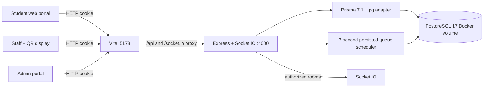

# Architecture

## Boundary responsibilities

- React only presents authoritative responses and subscribes to updates. On socket reconnect/focus it refetches REST state.
- Express validates Zod inputs, authenticates cookie sessions against `user_sessions`, enforces owner/role/staff-assignment checks, and emits only authorized queue/user events.
- The scheduler reads persisted queue state after each restart. It opens windows and converts only expired `CHECKIN_REQUIRED` tokens to `NO_SHOW` idempotently, but only for the current configured operating day.
- PostgreSQL constraints plus a transaction/advisory lock create sequential, collision-resistant display tokens.

## Roles

| Role | Allowed surface |
|---|---|
| Student | Public registration, own tokens/history, queue joins, authenticated QR confirmation |
| Staff | Assigned services, own queue operating controls, current QR |
| Admin | Locations/services, queues, staff assignments, policy, analytics/history, demo-only scenario |

Socket subscriptions are user-specific by default. A service queue room is granted only to an administrator or staff assigned to that service.

## Queue policy

`WAITING → CHECKIN_REQUIRED → CHECKED_IN → CALLED → SERVING → COMPLETED` is the normal path. Students may cancel before being called; staff may skip called/serving tokens; the scheduler alone marks overdue check-in windows as no-shows. The call selection policy is the lowest sequence `CHECKED_IN` token. Earlier unverified tokens remain pending until their deadline and can be bypassed; they are not prematurely no-showed.

Production defaults open a window for the next three pending tokens or at 10 estimated minutes, whichever happens first, with a five-minute grace window. Demo mode gives normal tokens a separately configured 15-minute window (`DEMO_CHECKIN_WINDOW_MINUTES`). The administrator's explicit no-show scenario alone uses the independent short `DEMO_NO_SHOW_GRACE_SECONDS` timer (35 seconds by default); it does not alter ordinary token deadlines.

## Daily queue sessions

QueueLess stores UTC timestamps, while the operating-day key is calculated in `CAMPUS_TIME_ZONE` (default `Asia/Kolkata`). Sessions are manual by policy: an administrator opens a service’s current-day queue, and may close it again. Opening is serialized with a PostgreSQL advisory lock and the `(service_id, session_key)` unique constraint, so repeated clicks or concurrent requests return the same current-day queue rather than duplicates. Reopening is permitted only for that same operating day; a historical closed session is never reactivated.

Closing preserves all records. It cancels pending `WAITING`, `CHECKIN_REQUIRED`, and `CHECKED_IN` tokens with a reason and per-token audit history; it refuses to interrupt a `CALLED` or `SERVING` token. Queue session decisions are stored separately in `queue_session_history` and broadcast through Socket.IO so staff, students, and administrators refresh their current-day view.
