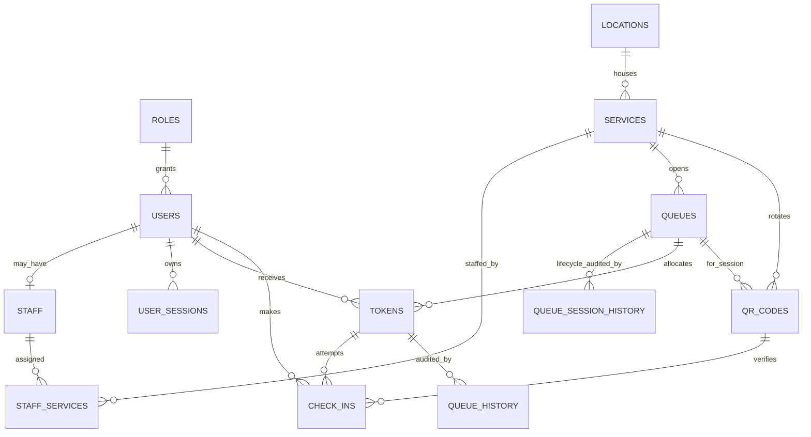
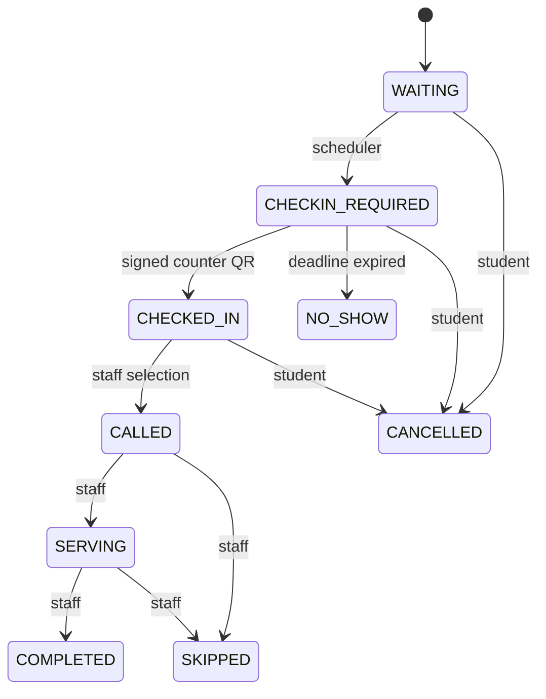

# Database design

The Prisma schema is the source of truth: [`apps/api/prisma/schema.prisma`](../apps/api/prisma/schema.prisma). Its initial PostgreSQL migration is checked in under `apps/api/prisma/migrations`.

Important constraints include unique role names, normalized unique emails, unique service short codes, one queue per service/session key, unique queue sequence, unique QR rotation hash, and a PostgreSQL partial index preventing more than one active token for a student in a queue. Foreign keys preserve history; disabling a service does not delete tokens.

`queues.session_key` is the `CAMPUS_TIME_ZONE` operating date, not a timestamp; timestamps remain UTC. The unique `(service_id, session_key)` constraint permits exactly one session per service/day. `tokens` stores the stable `checkin_opened_at` and `checkin_deadline_at`. `qr_codes` stores a SHA-256 hash of the rotation id, never the reusable signed payload. `check_ins` records successful and rejected attempts without exposing raw QR proofs. `queue_history` records token transitions, while `queue_session_history` records authorized session open/reopen/close decisions.

## Token state transitions

